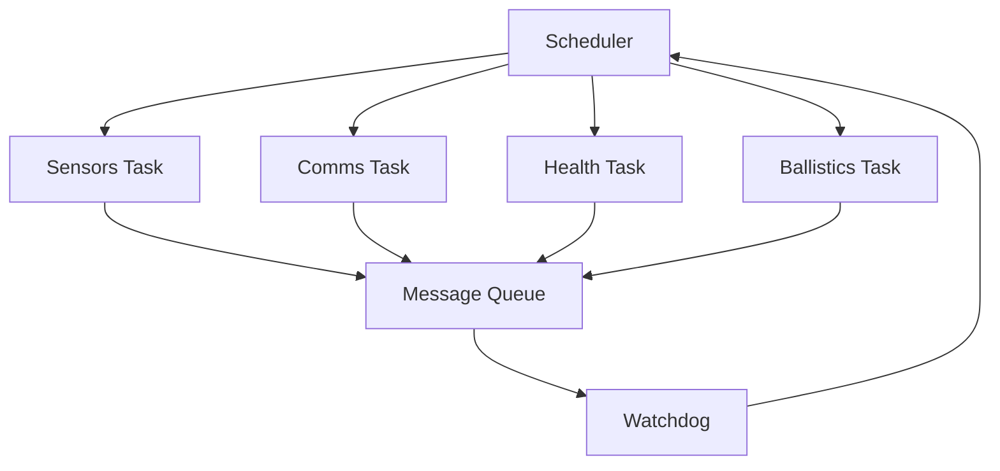

### Armée de Terre 🇫🇷
# 📘 VxWorks
   - Felin / RTOS / Inspired Kernel

--- 

<p align="left">

  <!-- Watchdog -->
  

  <!-- IPC -->
  

  <!-- Scheduler -->
  

  <!-- Ballistics -->
  

  <!-- Sensors -->
  

  <!-- Comms -->
  

</p>

---

### Système d’exploitation embarqué tactique
- — *Architecture modulaire militaire*
### Projet GitHub
- — **Armée de Terre**

---

### 🛰️ Felin‑RTOS
- — Noyau temps réel inspiré VxWorks
Système d’exploitation embarqué temps réel, inspiré des architectures VxWorks, INTEGRITY, et des systèmes tactiques du programme FÉLIN de l’Armée de Terre 🇫🇷.

Ce noyau fournit :
```markdown
- ordonnancement par priorités  
- watchdog militaire  
- message queue IPC  
- modules Sensors / Comms / Health / Ballistics  
- architecture modulaire  
- documentation complète  
- CI/CD GitHub Actions  
- compatibilité VxWorks / POSIX simulation  
```
---

🛡️ Badges techniques avancés

<p align="center">


<br>


<br>


</p>

---

### 🧩 Structure complète du projet
```markdown
VOIR structure.md et architecture.md dans docs/
```

---

### 🛰️ Architecture générale du noyau

**Diagramme ASCII**
```schema
                +---------------------+
                |     Scheduler       |
                |  (Priority-based)   |
                +----------+----------+
                           |
        +------------------+------------------+
        |                  |                  |
+-------v-------+  +-------v-------+  +-------v-------+
|   Sensors     |  |    Comms      |  |   Ballistics  |
|  (tSensors)   |  |  (tComms)     |  |  (tBallistics)|
+-------+-------+  +-------+-------+  +-------+-------+
        |                  |                  |
        +------------------+------------------+
                           |
                    +------v------+
                    |   Queue     |
                    |  IPC MsgQ   |
                    +------+------+
                           |
                    +------v------+
                    |  Watchdog   |
                    +-------------+
```

---

### 🧠 Diagramme Mermaid — Flux RTOS


---

### ⚙️ Fonctionnement interne

<p align="center">

  <!-- CI/CD -->
  

  <!-- Dernier commit -->
  

  <!-- Issues -->
  

  <!-- Pull Requests -->
  

  <!-- License -->
  

  <!-- Release -->
  

  <!-- Code Size -->
  

  <!-- Langages -->
  

  <!-- Activity -->
  

</p>

>🧵 Ordonnancement
- Priorité stricte  
- Tâches critiques : Ballistics, Sensors  
- Tâches secondaires : Comms, Health  
- Watchdog surveille les deadlines  

>🔐 IPC (Message Queue)
- FIFO  
- Messages inter‑modules  
- Buffer circulaire  
- Gestion des débordements  

>🛡️ Watchdog militaire
- Vérifie les tâches critiques  
- Timeout configurable  
- Reset logiciel  
- Mode dégradé si anomalie  

---

### 📡 Modules tactiques
| Module | Rôle | Priorité | Dossier |
|--------|------|----------|---------|
| Sensors | Acquisition terrain | Haute | /modules/sensors.c |
| Comms | Radio tactique | Moyenne | /modules/comms.c |
| Health | Intégrité système | Basse | /modules/health.c |
| Ballistics | Calculs balistiques | Très haute | /modules/ballistics.c |
| Watchdog | Surveillance | Critique | /src/watchdog.c |

---

### 🛠️ Compilation & Exécution

**VxWorks**
```text
make vxworks
ld <rtos.o>
rtos_start
```

**Linux Simulation (POSIX)**
```text
make sim
./felinrtossim
```

---

### 🧪 Tests unitaires
```text
make tests
./tests/test_watchdog
./tests/test_queue
```

---

### 🧬 CI/CD — GitHub Actions
Workflow : **.github/workflows/build.yml**

Fonctions :
```text
- compilation automatique  
- analyse statique (cppcheck)  
- artefacts RTOS  
- badge Build Passing  
```

---

### 📘 Documentation
Tous les documents sont dans /docs/ :
```text
- architecture.md  
- tasks.md  
- ipc.md  
- watchdog.md  
- ballistics.md  
```

---

### 🗺️ Roadmap militaire
```text
- [x] Watchdog militaire
- [x] Message Queue IPC
- [x] Architecture RTOS complète
- [ ] Scheduler interne avancé
- [ ] Module GPS tactique
- [ ] Module Radio cryptée
- [ ] Mode Combat / Mode Dégradé
- [ ] Logger sécurisé chiffré
- [ ] Analyse statique complète
````

---

### 🏁 Crédits
- Développement : The MadDoG.tmdg 
- Architecture : Felin.RTOS 
- Inspiration : VxWorks, INTEGRITY.

---


